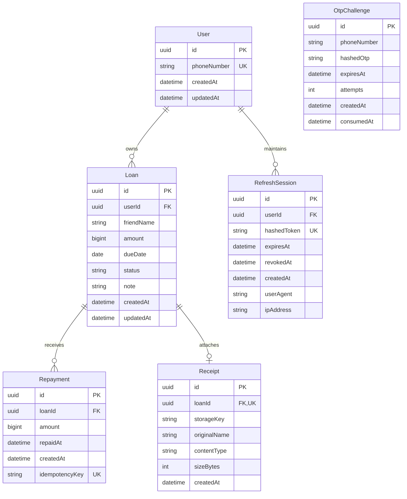

# MiniLedger Database Documentation

## 1. Relational Database Schema

MiniLedger uses PostgreSQL managed through Prisma ORM.

### Entity Relationship Diagram

---

## 2. Table Specifications & Constraints

### 2.1 `users`

- `id`: UUID Primary Key (`gen_random_uuid()`).
- `phoneNumber`: Unique normalized phone number (E.164 format, e.g. `+919876543210`).
- Strict deletion rules: Cannot delete user with active financial history (`onDelete: Restrict`).

### 2.2 `loans`

- `amount`: Stored as `BigInt` representing integer paise.
- `dueDate`: Explicit `@db.Date` without time components.
- `status`: Default `'OUTSTANDING'`. Valid values: `'OUTSTANDING'`, `'REPAID'`.
- Composite Indexes:
  - `[userId]` (Fast lookup of all loans for user)
  - `[userId, status]` (Filtered dashboard and tab queries)
  - `[userId, dueDate]` (Sorting and overdue calculations)

### 2.3 `repayments`

- `amount`: Integer paise (`BigInt`).
- `loanId`: Foreign key to `loans(id)`.
- `idempotencyKey`: Optional unique constraint preventing double-payments.

---

## 3. Migration Strategy

- Migrations are versioned under `services/api/prisma/migrations/`.
- Development: `npm run db:migrate` generates and executes local migrations.
- Production Release: `npx prisma migrate deploy` executes committed migration files without altering or dropping existing data.
